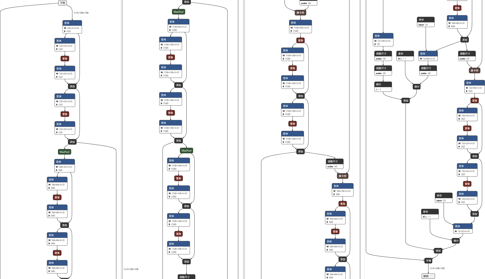
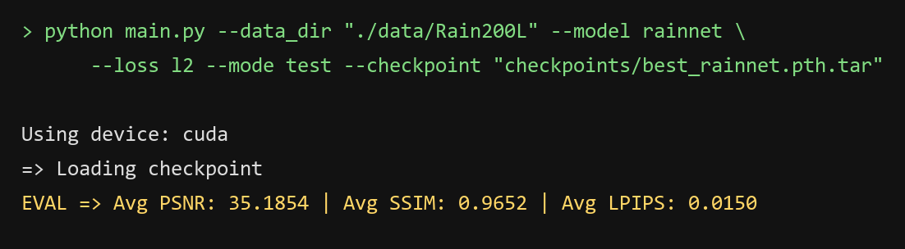
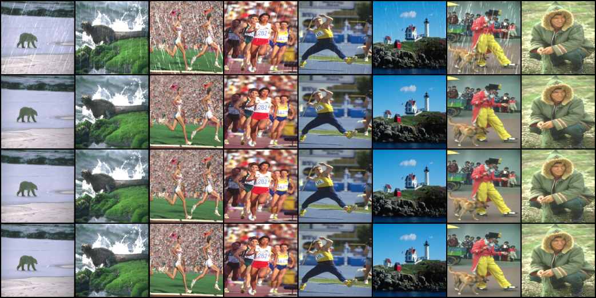

# Part2 第一部分 附加1：自己找方法，搭自己的模型

## 1. 我调研的两篇文章

题干给了两篇，我都读了。选它们不是因为没得选，是因为这两篇正好代表了这个领域两条不一样的路：PReNet 改的是「怎么训练」，SPANet 改的是「怎么判断哪里是雨」。

### 1.1 PReNet：把一个浅网络反复展开

论文：*Progressive Image Deraining Networks: A Better and Simpler Baseline*，Ren 等人，CVPR 2019，arXiv:1901.09221。

**它做的事，一句话说就是：不把网络做深，而是把同一个浅网络重复跑几遍。**

主干叫 PRN（Progressive ResNet），本质上就是一个 5 个残差块的浅网络。它被展开成多个 stage，默认 6 个，而这 6 个 stage 用的是**同一套权重**。

```text
x0 = 有雨图

第 t 步： r_t = PRN( x_{t-1}, x0 )      ← 两个输入：上一版结果 + 原始雨图
         x_t = x_{t-1} - r_t

共 6 步，PRN 的权重 6 步共用
```

有三处细节值得单独记下来。

**第一，每个 stage 都同时吃原始雨图。** 不是只吃上一阶段的输出。这一点容易看不懂：都处理过一遍了，还喂原图干什么？但它解决的是一个真问题——连续处理会让细节磨损，每轮把原图重新喂进去，等于每轮都对一次账，模型能直接看到「我上一轮改过头了」。

**第二，参数量几乎不涨。** 五个残差块展开 6 次，参数量还是一份。论文里还有个 PRN_r，把每个 stage 里的残差块也递归共用，最后只剩下一个残差块在反复用，参数进一步往下掉。

**第三，损失用负 SSIM 比用 MSE 好。** 这是论文明确写了的结论。SSIM 本身就是从亮度、对比度、结构三项去比两张图，和人的观感更接近，把它取负当损失，等于直接优化一个更像感知指标的分数。我在 Part1 任务二里讨论过 L1 和 L2 的取舍，这篇给了第三个选项，是我没想到的。

Rain100H 上的数：

```text
PRN       PSNR 28.07   SSIM 0.884
PReNet    PSNR 29.46   SSIM 0.899
PRN_r     PSNR 27.43   SSIM 0.874
PReNet_r  PSNR 28.98   SSIM 0.892
```

最上面两行和最下面两行是同一个网络的不同展开方式，参数差了一个量级，PSNR 只差 0.5 到 1 dB。这个对照本身就说明：在这类任务上，「怎么组织」比「堆多少参数」更值钱。

**对我的启发有四条：**

**一是有效深度可以不花钱。** 权重共享跑 6 次，网络的有效深度变成 6 倍，参数一份没多。这条直接框住了我后面搭模型的参数量——不需要靠堆通道数去换性能。

**二是「每轮都对一次账」是个很便宜的设计。** 我原来的思路是先把它做深，让它自己记住原图；PReNet 是每轮重新喂一遍。后者不需要任何额外结构。

**三是中间监督没用来提分，只用来让早期结果好看。** 论文里说对中间 stage 加监督不能提高最后一阶段的性能。这条让我打消了在报告里写「我对每个雨头都加了监督所以更好」的念头——加了也不一定更好，得实测。

**四是负 SSIM 这个损失。** 这一部分题干规定只能用 L2，所以我没换。但我把它记下来了，因为它是同一件事的另一种问法：比像素差，还是比结构是不是像。

### 1.2 SPANet：先在空间上把雨找出来，再删

论文：*Spatial Attentive Single-Image Deraining with a High Quality Real Rain Dataset*，Wang 等人，CVPR 2019，arXiv:1904.01538。

**它做的事，一句话说就是：把去雨拆成「先找哪里是雨，再把雨删掉」两步。**

这个思路叫 removal-via-detection。主干是这样：

```text
3 个残差块            抽特征
     │
4 个 SAB              逐个找出雨的位置
  └ 每个 SAB = 3 个 SARB + 1 个 SAM
     SARB  空间注意力残差块，负责删
     SAM   空间注意力模块，负责出「哪里是雨」这张图
     SAM 的权重在 4 个 SAB 之间共享
     │
2 个残差块            重建背景
```

还额外用了一个**两轮的四方向 IRNN**：分别在上下左右四个方向上做循环卷积，把远处邻居的信息沿方向传过来，两轮之后一张特征图上任意一点都能看到整个画面。

为什么非要空间注意力、不用通道注意力？论文给的理由是：**雨和背景在某些时候看起来一模一样**。白色的电线、浅色的窗框边缘、亮背景上的细长高光，外观上和雨丝没有区别。光看这一小块的颜色统计，分不开；只能靠「它周围上下是什么」这种上下文去判断。这也解释了为什么要有四方向 IRNN——雨丝是长条状的，可以朝任意方向，上下文必须能沿着四个方向传过来。

SAM 的权重在四个 SAB 之间共享，这一点和 PReNet 是同一个设计取向。

这篇还自己造了一个数据集，约 29.5K 对真实雨天图像，半自动生成：利用时间先验（一段连续视频里前后帧的差异能看出雨在哪），再加人工标注。仓库里报的数是 PSNR 38.02 → 38.53，SSIM 0.9868 → 0.9875。

**对我的启发有三条：**

**一是「找」和「删」可以拆开。** 这是我看完最直接的想法。如果网络要先判断「这块是雨」，再决定「删多少」，那它删的时候是有依据的，不是凭像素值瞎减。我后面设计的三个雨头，某种程度上也是这个意思——不同的头负责不同尺度的「找」。

**二是数据可能比结构更决定上限。** 这篇自己造数据集这件事，比它的模块更让我在意。后来任务二的结果把这条印证了：DerainNet 参数是 BaselineNet 的 3.3 倍，50 轮平均只高 0.59 dB，因为在 Rain200L 上感受野不是瓶颈（见 任务二 3.5 节）。换成它这种更真实、更复杂的雨，同样的结构差距会被放大。

**三是共享权重的做法在三个地方重复出现。** PReNet 的 stage 之间共享，PRN_r 的残差块共享，SPANet 的 SAM 四个 SAB 之间共享。三篇不同的工作、同一个选择，说明这不是巧合，是这个领域的共识：比起堆更多不同的判断器，反复使用同一个判断器更划算。

### 1.3 两篇放在一起看

```text
                PReNet                        SPANet
改的是         怎么训练、怎么组织             怎么判断哪里是雨
手段           权重共享 + 多阶段展开           空间注意力 + 四方向上下文传播
参数效率       极高（一份权重跑 6 次）         同样靠 SAM 共享控制
输出           每一步都预测雨层                预测注意力图，再据此删
```

共同点只有三条，但都是关键的：

```text
都在「反复地做小修正」，而不是「一次到位地大改」
都靠权重共享控制参数量
都把「预测雨层 / 注意力图」而不是「直接预测干净图」当成中间产物
```

第三条是我这次搭模型直接照搬的。任务一里 `MyModel` 就是这么写的：`y - convout(convin(x))`，网络只学雨，背景原样保留。

## 2. 我平时怎么找文章

说实话，这次我没有做系统性检索，主要就是题干给的两篇加顺着它们的引用往外看了一圈。下面这套流程是我接下来会用的，也是我看完这两篇之后总结出来的。

**第一步，先有几个锚点。** 一个完全陌生的领域，直接搜关键词会被埋掉，因为相关论文太多，标题还都长得差不多。正确做法是先拿到 3 到 5 篇公认的起点论文——综述、经典方法、或者题干直接给的。这次的锚点就是 PReNet 和 SPANet。

**第二步，顺着引用关系往外扩，两个方向都走。**

```text
往下看：这两篇引用了谁       →  它们的前辈在解决什么问题
往上看：谁引用了这两篇       →  后续工作是怎么改进它们的
```

工具上，Google Scholar 每篇论文下面的 "Cited by" 是最直接的，点进去按时间排序就能看到这一支的发展脉络。想一次看全貌可以用 Connected Papers 或 Semantic Scholar 的引用图，能直接画出上下游。

**第三步，用固定关键词在 arXiv 上按时间倒序看最近两年的。**

```text
single image deraining
rain streak removal
real-world rain removal
deraining transformer
```

理由很实际：新论文的引言和实验表格，会把整个领域的现状压缩在里面——它跟谁比、谁现在最高、大家公认的难点是什么，一张表全都有。这比自己从头读五篇要快得多。

**第四步，按三个条件筛。**

```text
1. 发表在什么会议 / 期刊      CVPR、ICCV、ECCV、TPAMI 优先
2. 有没有开源代码             有代码是巨大加分，能跑才能验证
3. 被引次数                   高被引说明这个方向被认可，不代表最好但有代表性
```

**第五步，建一张表记下来。** 不记的话看完就忘，几篇文章的结论会在脑子里搅在一起。我的表是这六列：

```text
标题 | 一句话方法 | 它解决的具体问题 | 用的数据集 | 代码链接 | 我没看懂的地方
```

最后一列最有用。它是我回头查的清单，也是我自己的模型要不要用这个模块的判断依据——如果一个模块我没搞懂它解决什么问题，那它搬到我的模型上大概率也是白搭（这一点在第 6 节会展开）。

## 3. 一篇文章读不进去的时候怎么办

这个问题这次真踩到了。SPANet 的四方向 IRNN 是最容易卡住的一段，因为它默认你已经知道「为什么非得是四个方向，两个不行吗」。下面这六条是试过之后有用的，按用起来的顺序排。

**一是先看视频讲解和中文博客，建立框架，再回原文核对。** 不丢人，而且效率差很多。我看 MoCo 那篇对比学习综述的时候就是这么用的：先花二十分钟把「这条线到底在解决什么问题」搞清楚，再回去看原文的结构图和公式，几乎是一眼就懂。要是上来就硬啃英文 PDF，光一个术语就能耗掉半天。

但要提醒自己一句：视频是别人嚼过的，会有简化，也可能不准确。所以它只用来建立框架，具体数字、具体模块还是要回原文核对。

**二是第一遍只看图和表，不看正文。** 拿到一篇论文先回答三个问题：

```text
输入是什么、输出是什么？
中间那张结构图画了几个模块、怎么连的？
实验表格里它比谁高、高多少？
```

这三个问题答完，方法已经懂了大概一半，剩下的细节再回去读正文才有地方挂。

**三是公式看不懂就跳过，先去看代码。** 这两篇都有官方开源代码。一个 stage 在代码里可能就五行，比啃三页公式快得多。公式的作用是精确，代码的作用是直观，先直观后精确。

**四是术语卡住就立刻查，不要硬扛。** SSIM、感受野、IRNN、注意力图，任何一个词不懂，后面整段都读不进去。查一个记一个，这几个词是后面所有论文的公共词汇，查一次够用很久。

**五是读不下去就换一篇，第二遍再回来。** 这两篇就有前后关系：PReNet 讲的是「权重共享 + 多阶段」，SPANet 讲的是「沿四个方向传播上下文」。前者读完再看后者，会更容易理解它为什么非要两轮四方向——一轮只能看到局部，第二轮才把远处接上。有些论文是需要别的论文当垫脚石的。

**六是用自己的话写一段，写给完全不懂的人看。** 写不出来就是没懂。判断标准很简单：如果一段话只能把原文的句子换个说法，那是抄，不是懂；能讲清楚「为什么要这样设计、不这样会怎样」，才算过了。这份报告的第 1.1 和 1.2 就是按这个标准写的。

## 4. 渐进式训练

### 4.1 到底是什么

「渐进式训练」这个词在文献里其实指两件不一样的事，我一开始也混了，先分开。

```text
意思一（PReNet 这一支说的）
  网络内部有 K 个 stage，前一个的输出是后一个的输入，
  K 个 stage 一起端到端训练，不是一个一个训

意思二（课程学习那一支说的）
  先用小图 / 简单样本训，训好了再逐步放大尺寸、提高难度
```

这两篇里只有 PReNet 属于**意思一**。SPANet 是单阶段的，它在一个 stage 内部用四方向 IRNN 扫一遍空间上下文，再把注意力挂上去，没有「前一轮输出喂给后一轮」这个结构，所以它跟渐进式无关。这两个意思容易混，因为「渐进」读起来都像「由易到难」，但意思一里的「渐进」描述的是**推理时的行为**——一轮比一轮干净，不是训练时先易后难。

这里还有一个更容易混的地方，必须写清楚：**`epochs` 不是 stage，两者完全无关。**

```text
main.py 里的 --epochs（默认 20，这次附加1 跑的是 200）
  = 同一个网络在数据集上过了 200 遍
  = 每一遍都从原始雨图重新开始，输出直接和真值比
  ≠ 渐进式

PReNet 的 6 个 stage
  = 一张图在同一个网络里走了 6 遍
  = 后一遍的输入是前一遍的输出
  = 渐进式
```

这两个数字放在一起很容易被当成一回事——都是「跑好几遍」，只是单位不同。但 `--epochs 200` 训的是一个单阶段模型 200 遍，它离渐进式还差一个关键的东西：**前一遍的结果要变成后一遍的输入**。少了这一条，跑多少遍都还是单阶段。

而且要说清楚，PReNet 的训练方式**不是**先训 stage1、训好了再冻住训 stage2。它把 6 个 stage 串成一个计算图，一次性反传。如果真按前者做，后一个 stage 就得面对一个已经固定了的、可能不理想的输入，那是另一套做法（类似贪心的逐层训练），PReNet 没有这么做。

### 4.2 为什么现在这些工作都用它

**第一个理由，有效深度乘以 K，参数量不变。** 这是最直接的收益。同一组权重跑 6 次，等于一个 6 倍深的网络，参数一份没多。按 1.1 里 PRN 和 PRN_r 的对照看，即使把每个 stage 内部也递归压缩到只剩一个残差块，PSNR 也只掉 1 dB 左右，说明「反复」本身带来的收益比「每一层有多强」更大。

**第二个理由，每一步的目标都比「一次到位」容易。** 单阶段模型要从一张带雨的 128×128 一次映射到干净图，所有误差压在一条长链上反传。多阶段模型每一步只改一点点，学的是「在上一版基础上再修一修」，这个映射比「从零到一」简单得多。

这个理由和我在任务二里的观察是同一件事的两面。任务二 3.5 节说，多尺度分支的优势在训练早期最明显（前 20 轮平均领先 0.71 dB），后期被 baseline 追上（后 20 轮只剩 0.49）。我当时把原因归到「数据集用不上感受野」。现在看完 PReNet，我觉得还有一层：**它让优化走得更快，而不是把天花板抬高**，这句话我在任务二里也写了。渐进式的道理是一样的——它主要是在降低优化的难度，不是凭空增加表达能力。

**第三个理由，每一阶段都能重新吃原图。** 这是我认为最被低估的一条。反复处理会磨损细节，每轮把原图喂回去，等于每轮强行对一次账。它不需要任何额外模块，只是把一个张量多接了一条线。

### 4.3 和出题人给的训练方法差在哪

```text
                    出题人的 main.py          PReNet
网络结构             单次前向                   K 次前向，权重共享
输入                 始终是原始雨图              第一个 stage 是原图，
                                               之后是「上一版结果 + 原图」
监督信号             只在最终输出上算损失          默认也是只在最后一步，
                                               可以加中间监督（论文说提不了分）
训练方式             端到端一次反传               端到端一次反传（一样）
推理成本             1×                        K×
显存                 1×                        K×
```

最关键的一条是倒数第二行和倒数第三行：**训练方式其实一样，差别全在网络结构和推理成本上。** 所以「渐进式」不是一个训练技巧，是一个网络设计，只不过它的收益要在训练过程中才体现出来。

从 main.py 的角度说，要改成渐进式，需要动的是模型本身：让 `forward` 里多一个循环，而不是让 `train_one_epoch` 多一个循环。很多人第一次听「渐进式训练」会以为要去改训练循环，方向错了。

### 4.4 优劣

**好处三条：**

1. **参数效率极高。** PReNet 用很浅的 PRN 就拿到了当年有竞争力的结果，论文标题直接写的就是 "A Better and Simpler Baseline"。
2. **收敛更稳。** 每一步的目标都小，不容易一上来就跑偏。这和 Part2 第一部分任务二 1.6 节讨论过的「训练初期在从 15 dB 往回爬」正好相反——那种情况是一次性映射没找好起点，渐进式天然不会一下子走那么远。
3. **中间结果可解释。** 第一轮去掉大部分雨、后面几轮修细节，这个过程是能看出来的，出问题也容易定位到是哪一轮。

**代价四条，都不能忽略：**

1. **推理慢 K 倍。** 6 个 stage 就是 6 次前向。手机端去雨、视频实时去雨这类场景，这一条是硬伤，直接决定了它能不能用。
2. **显存 K 倍。** 训练时要留 K 个 stage 的中间激活才能反传。同样是 6 个 stage，显存占用可能是单阶段的数倍。
3. **误差累积。** 第 1 步如果把背景误判成雨删掉了，后面每一步都拿这个错的结果往下走，越走越偏。PReNet 用「每步都喂原图」缓解，但没有根治——原图能帮它发现改过头了，但也可能把它拉回上一轮的错误。
4. **超参数变多。** K 取多少、共不共享权重、要不要中间监督、中间监督的权重多大，每个都要调。引入一个范式的同时引入了四个新旋钮。

### 4.5 如果我去做科研，会不会照搬

我的答案是：**不照搬范式，照搬判断依据。**

渐进式能成立的真正条件是——**「重复做同一件事有累积收益」**，也就是第 t 次修正比一次性修正容易。这个条件在很多任务上成立：去雨成立，因为雨是叠加的，一层一层剥是自然的；去噪、去雾、超分也大体成立。

但它不总是成立。如果任务里没有一个「反复做有用」的结构，硬套渐进式就是纯成本——K 倍推理、K 倍显存，换来的可能只是「能训到同样分数但慢 K 倍」。

所以正确的问法不是「大家用什么范式，我也用」，而是：

```text
我的任务里，有没有一个「做两遍比做一遍好」的结构？
如果有，那是哪一部分需要反复做？（去雨里是「判断哪里是雨」）
如果没有，渐进式就只是成本。
```

具体到我这次：题目不要求渐进式，我也没做。但我的设计里留了一个类似的东西——**三个雨头**。它不是时间上的多阶段，是尺度上的多层次：同一时刻，三个不同分辨率的头各自给出一版雨层，再加权融合。好处是没有 K 倍推理；代价是它拿不到「上一轮改完再看一遍」的累积效应，三个头是同一次前向里并行算出来的，互相看不见对方的结果。

如果重做，我会把三个雨头改成**共享权重的递归**，用 3 步展开：第一个头在 1/4 分辨率上粗去一遍，第二个头吃它的结果再修，第三个头再修。这样既有尺度的层次，又有时间的累积，参数还是共享的，代价是推理变成 3 倍。这是我这次做完了才想明白的一个改进方向。

## 5. 我搭的模型

### 5.1 设计思路

参考了 1.3 里三条共同点，最终结构是这样：

```text
输入 (B, 3, 128, 128)
   │
   ▼ 入口卷积  3 → 32
   │
   ├─ 128×128   2×ResBlock(32)                        ────┐ 跳连 s1
   ├─ pool → 64×64    conv 32→64    2×ResBlock(64)    ────┼────┐ 跳连 s2
   ├─ pool → 32×32    conv 64→128   2×ResBlock(128)   ────┼────┼────┐ 跳连 s3
   ├─ pool → 16×16                  2×ResBlock(128)   ────┘    │    │ 瓶颈
   │                                                           │    │
   ▼ up → 32×32    concat s3 → conv 256→128 → 2×ResBlock(128) ─┘    │  → 雨头①
   ▼ up → 64×64    concat s2 → conv 192→64  → 2×ResBlock(64)        │  → 雨头②
   ▼ up → 128×128  concat s1 → conv 96→32   → 2×ResBlock(32)        │  → 雨头③
   │
   ▼ 三个雨头各上采样到 128×128，用三个可学习标量加权求和
   │
 rain (B, 3, 128, 128)
   │
   ▼ 原图 − rain
 输出 (B, 3, 128, 128)
```

三个设计点，各对应前面读到的哪一条：

**第一，用残差块而不是裸卷积。** 每个 ResBlock 是 `conv3x3 → ReLU → conv3x3 → 加回输入`。参考 PReNet 的递归残差块和 ResNet 的恒等映射。理由很实际：200 轮训练下，纯卷积堆深的模型容易出现梯度衰减，残差那条直通路径让梯度能直接回传。

**第二，输出雨层，不直接输出干净图。** 参考 PReNet 和 SPANet 共同的做法（1.3 第三条），也是任务一 `MyModel` 里已经在用的写法。好处是网络只需要学「雨长什么样」——一个稀疏的东西，大部分像素是 0；背景直接抄输入，不用重画一遍。

**第三，三个雨头加权融合。** 这是我自己加的部分，参考 SPANet 的多尺度思想，但把它退化成更简单的形式。浅层 128×128 分辨率高，看到的雨丝细；深层 32×32 感受野大，看到的是整片雨雾的走向。三个头各自出一版雨层，再用三个可学习标量加权，让网络自己决定该信哪个尺度。

**还有一个容易漏掉的细节：下采样之后要补一个卷积。** `MaxPool2d(2)` 只把高宽减半，通道数原样不动，所以 `pool` 之后还是 32 通道，而下一级要的是 64。这里各补一个 3×3 卷积把通道翻倍，两个卷积一共 92,352 个参数。

我第一版设计图里把这一步漏了，代码跑起来在第二级直接报

```text
RuntimeError: Given groups=1, weight of size [64, 64, 3, 3],
expected input[2, 32, 64, 64] to have 64 channels, but got 32 channels instead
```

才意识到「降分辨率」和「升通道」是两件互相独立的事，池化只做前一件。这也解释了一件事：编解码结构里每一次尺度变化，尺寸和通道数是分开处理的，尺寸靠 pool / up，通道靠卷积，不能指望一个操作同时干两件事。

**为什么不用 SPANet 的空间注意力。** 两个原因：一是它依赖四方向 IRNN 提供全局上下文，单独抠出注意力模块塞进来，拿到的输入不是它设计时要的那个；二是算力，IRNN 要在大特征图上沿四个方向反复循环，128×128 上太慢。这一点第 6 节会再展开。

### 5.2 代码与逐类标注

代码在 `models/mymodel.py`，和任务一的 `MyModel` 放在同一个文件里，但两个类互不相干：`MyModel` 是任务一用来跑通「输入减雨层」这条通路的最小对照，只有两个卷积、3,523 个参数；`RainNet` 是附加1 的正式模型。不新建文件是因为 Q.md 里写的是「在 `MyModel` 文件中搭建」，而且这样两次提交的差异集中在一处。

实际参与运算的是两个类：`ResBlock` 和 `RainNet`。

#### 第一个类：ResBlock

```python
class ResBlock(nn.Module):
    def __init__(self, ch):
        super(ResBlock, self).__init__()
        # 两层 3×3 卷积夹一个 ReLU，输入输出的通道数和分辨率都不变
        self.model = nn.Sequential(
            nn.Conv2d(ch, ch, 3, padding=1),
            nn.ReLU(),
            nn.Conv2d(ch, ch, 3, padding=1),
        )

    def forward(self, x):
        # 残差：让这一块只学"在输入上改多少"，而不是从零画出特征
        y = x
        x = self.model(x)
        x = x + y
        return x
```

设计思路是不让它改变任何形状。通道保持 `ch` 不变，`padding=1` 让 3×3 卷积不缩尺寸，所以这个块的输入和输出在形状上完全一样，可以随便插到哪一级里，也不用担心和跳连拼不上——这一点在用 `torch.cat` 拼特征的时候很要紧，拼错一个通道数就是一次 `RuntimeError`。

它的作用是承担 RainNet 全部的特征提取和重建，整个网络里一共 14 个：编码器 2+2+2、瓶颈 2、解码器 2+2+2。

参考的是 ResNet 的恒等映射。PReNet 里的递归残差块也是同一个做法，它那 5 个块的 PRN 主干就是这么堆起来的，区别只在 PReNet 会把这个主干反复用 6 次。

这里没有加 BatchNorm。残差块里一旦插了 BN，`x + y` 那条路径上就多了一次归一化，加回去的就不再是原来的输入，恒等映射这个性质就破了。另外 batch 只有 8，到 1/16 分辨率时特征图只剩 16×16，统计量本来也不稳。

#### 第二个类：RainNet 的构造

`__init__` 分三段，按数据流的顺序排。

```python
        # ---- 公共部件 ----
        self.conv_in = nn.Conv2d(3, 32, 3, padding=1)
        self.pool = nn.MaxPool2d(2)
        self.up = nn.Upsample(scale_factor=2, mode='bilinear', align_corners=False)

        # 池化只改分辨率不改通道，所以每次下采样后要补一个卷积把通道翻倍
        self.down1 = nn.Conv2d(32, 64, 3, padding=1)
        self.down2 = nn.Conv2d(64, 128, 3, padding=1)
```

第一段是四个工具件。入口把 3 通道的 RGB 拉到 32 通道，`pool` 和 `up` 负责改分辨率，两个 `down` 卷积负责改通道。把它们分开是有原因的，5.1 里已经写过第一次跑的时候在这里报错过。

```python
        # ---- 编码器：分辨率减半、通道翻倍 ----
        self.enc1 = nn.Sequential(ResBlock(32), ResBlock(32))          # 128×128
        self.enc2 = nn.Sequential(ResBlock(64), ResBlock(64))          #  64×64
        self.enc3 = nn.Sequential(ResBlock(128), ResBlock(128))        #  32×32
        self.bottleneck = nn.Sequential(ResBlock(128), ResBlock(128))  #  16×16

        # ---- 解码器：先把跳连拼进来，再用卷积把通道压回去 ----
        # 括号里是拼接后的通道数 = 上采样后的通道 + 跳连的通道
        self.bridge3 = nn.Sequential(
            nn.Conv2d(128 + 128, 128, 3, padding=1), nn.ReLU())
        self.dec1 = nn.Sequential(ResBlock(128), ResBlock(128))
        self.bridge2 = nn.Sequential(
            nn.Conv2d(128 + 64, 64, 3, padding=1), nn.ReLU())
        self.dec2 = nn.Sequential(ResBlock(64), ResBlock(64))
        self.bridge1 = nn.Sequential(
            nn.Conv2d(64 + 32, 32, 3, padding=1), nn.ReLU())
        self.dec3 = nn.Sequential(ResBlock(32), ResBlock(32))
```

第二段是编解码骨架。`bridge` 这三个卷积里的通道数我写成 `128 + 128` 这种形式而不是直接写 256，是因为这个数是最容易改错的地方：上采样把通道数原样带过来，拼接再把跳连的通道加上去，两个来源必须分别对上。写成一个加法，改结构的时候哪一边动了能一眼看出来。

瓶颈那一级的通道数和 enc3 一样都是 128，看起来像是可以省掉一层。留着的理由是分辨率还在继续降（32→16），如果这时不减通道，那一级的计算量会是整网最大的一块；反过来如果继续加通道，在这个数据集上 2.67M 参数已经不算小了。

```python
        # ---- 三个雨头：各自把本级的特征压成 3 通道雨层 ----
        self.head1 = nn.Conv2d(128, 3, 3, padding=1)   # 32×32
        self.head2 = nn.Conv2d(64, 3, 3, padding=1)    # 64×64
        self.head3 = nn.Conv2d(32, 3, 3, padding=1)    # 128×128

        # 三个尺度雨层的融合权重。写成 nn.Parameter 它才会进优化器一起学
        self.w = nn.Parameter(torch.ones(3))

        # 三个雨头零初始化：这样第 0 步雨层恒等于 0，输出严格等于输入，
        # 训练从「什么都不做」的 PSNR 起跑，而不是从 15 dB 往回爬。
        # 理由详见 Reports/Part2-第一部分-任务二.md 第 1.6 节。
        for h in (self.head1, self.head2, self.head3):
            nn.init.zeros_(h.weight)
            nn.init.zeros_(h.bias)
```

第三段是三个雨头和融合权重。三个头都是 1×1 意义上的「降维卷积」，只是用了 3×3 的核让它能看一眼邻域，把 128 / 64 / 32 通道压到 3 通道。

`w` 必须是 `nn.Parameter` 而不是 `torch.tensor`。写成普通张量它就是个常量，`requires_grad` 是 `False`，优化器收不到它，三个权重会一辈子停在 1.0，等于没做加权。这一点我写完先检查了一遍 `m.parameters()` 里有没有它，确认了才继续。

零初始化这三个头，是整套设计里唯一一处「照着别人的做法抄过来但完全成立」的地方，它在任务二 1.6 节已经验证过一次：雨头初始为 0，第 0 步输出的雨层就恒为 0，`x - 0 = x`，模型的初始分数等于「什么都不做」的 27.89 dB，而不是随机初始化那种 15 dB 的低谷。训练从哪起步，决定了前几十轮是在补亏空还是在涨分。

#### 第三个：RainNet 的前向

```python
        # 注意 s2 是从 s1 池化来的，s3 从 s2 来，不是三个都从 f 来
        f = self.conv_in(x)
        s1 = self.enc1(f)
        s2 = self.enc2(self.down1(self.pool(s1)))
        s3 = self.enc3(self.down2(self.pool(s2)))
        b = self.bottleneck(self.pool(s3))

        # 解码：每一级把上一级的结果上采样后和同级跳连拼起来
        d3 = self.dec1(self.bridge3(torch.cat([self.up(b), s3], dim=1)))
        r1 = self.head1(d3)
        d2 = self.dec2(self.bridge2(torch.cat([self.up(d3), s2], dim=1)))
        r2 = self.head2(d2)
        d1 = self.dec3(self.bridge1(torch.cat([self.up(d2), s1], dim=1)))
        r3 = self.head3(d1)

        # 三个尺度的雨层都放大到 128×128 再按学到的权重加权
        rain = self.w[0] * self.up(self.up(r1)) + self.w[1] * self.up(r2) + self.w[2] * r3
        return x - rain
```

编码那五行容易写错的是「从哪一级池化」。`s2` 是从 `s1` 池化来的，`s3` 从 `s2` 来，层级是串起来的，不是四个都从 `f` 分别池化——那样三级的感受野会一样大，多尺度的意义就没了。

解码每一级做三件事：把上一级的结果上采样、和同级的跳连拼起来、过桥接卷积把通道压回去。跳连接的是 `dec` 的输出（`d3` / `d2`）而不是 `head` 的输出，因为头只出 3 通道的雨层，拿去做跳连信息太少了。

`torch.cat` 的 `dim=1` 不能省，也不能写成 `nn.cat`——`nn` 里没有这个函数，是 `torch.cat`，而且第一个参数必须是列表。

最后三行是融合。`r1` 在 32×32 上，要放大两次才到 128×128；`r2` 在 64×64，放大一次；`r3` 本来就是 128×128，不动。这里我第一版写错过：既给 `r1` 赋了一次 `self.up(self.up(r1))`，又在加权表达式里再放大一次，等于放大了四倍，形状直接对不上。这类错误报错信息很清楚（尺寸不匹配），只要肯看报错就能定位。

整个前向的形状变化，代码里那张对照表已经列全了，这里不重复。

### 5.3 ONNX 与参数量

Q.md 要求「学习使用 ONNX，创建并编写一个简单的计算模型参数的代码，运行后在 netron.app 中运行」。

导出脚本是 `导出onnx.py`，加了一个 `rainnet` 分支：

```cmd
python 导出onnx.py --model rainnet
```

实际输出：

```text
[OK] onnx\rainnet.onnx
     参数量 2,673,100  文件大小 10.22 MB
```

**参数量 2,673,100**，也就是 2.67M。按部件拆开：

```text
部件                参数量       占比
入口 conv_in            896    0.03%
下采样 down1         18,496    0.69%
下采样 down2         73,856    2.76%
编码器 enc1          36,992    1.38%
编码器 enc2         147,712    5.53%
编码器 enc3         590,336   22.08%
瓶颈 bottleneck     590,336   22.08%
桥接 bridge3        295,040   11.04%
解码器 dec1         590,336   22.08%
桥接 bridge2        110,656    4.14%
解码器 dec2         147,712    5.53%
桥接 bridge1         27,680    1.04%
解码器 dec3          36,992    1.38%
三个雨头 head        6,057    0.23%
融合权重 w                 3    0.00%
──────────────────────────────────────
合计              2,673,100     100%
```

手算能对上的两项可以当校验：一个 `ResBlock(128)` 是 `2 × (128×128×3×3 + 128) = 295,168`，`enc3` / `bottleneck` / `dec1` 各装两个，都是 590,336；`bridge3` 是 `256×128×9 + 128 = 295,040`。光这四个 128 通道的编解码级就占了 2,361,344，是全网的 88%。

**和 4M 上限的关系**：2,673,100 是 4M 的 66.8%，留了约三分之一余量。

这里要澄清一个容易混的地方：ONNX 文件是 10.21 MB，超过了 4。原因是 ONNX 用 float32 存权重，每个参数 4 字节，`2,673,100 × 4 ≈ 10.7 MB`，和实际文件大小对得上。所以「4M」指的是参数量，不是文件字节数——`DerainNet` 1,000,451 个参数导出来是 3.83 MB，如果按文件大小卡 4M，一个 1M 参数的模型就已经贴着上限了，这个限值就失去了意义。

**netron 里的结构**：



图上数节点能反过来校验代码：

```text
算子        个数    对应什么
Conv         37    14 个残差块 × 2 + 入口 1 + 下采样 2 + 桥接 3 + 雨头 3
Add          16    14 个残差块的恒等相加 + 三个雨层加权求和时的 2 次
Relu         17    14 个残差块内各 1 + 3 个桥接卷积后各 1
Resize        6    up 被调用 6 次：桥接 3 次，r1 放大两次、r2 放大一次
MaxPool       3    s1→s2、s2→s3、s3→瓶颈，共三次下采样
Concat        3    三次跳连拼接
Mul           3    三个尺度雨层各乘一个可学习权重
Sub           1    最后那一次 x − rain
────────────────────────────────────
节点总数     96
```

`Resize` 是 6 个、`Sub` 只有 1 个，这两个数最能说明结构对不对。上采样如果少调用几次，`Resize` 就会对不上；残差那条直通路径如果断了，`Sub` 的位置会跑到图中间去。图上最上面那条从 `rainy` 直接绕到底下 `Sub` 的线，就是这条直通路径。

还有一件和这次提交过程有关的事：第一次执行导出命令报的是

```text
AttributeError: module 'onnx' has no attribute 'load_model_from_string'
```

不是 onnx 版本太老，是仓库里那个用来放导出结果的 `onnx\` 文件夹，名字和 `onnx` 包重名了，Python 在脚本目录里先找到了这个空文件夹，把它当成了命名空间包。装上 onnx 之后真包优先级更高，问题就消失了。下次如果在别的项目里见到类似的「某个包突然没有某个属性」，可以先看一眼工作目录里有没有同名的文件夹。

### 5.4 训练与测试结果

训练配置：

```text
数据集        Rain200L，训练 1800 对 / 测试 200 对
输入          resize 到 128×128
batch / lr    8 / 1e-4，Adam
损失          L2（第一部分规定只能用 L2，见 Q.md）
轮数          200
参数量        2,673,100，是 4M 上限的 66.8%
```

训练命令：

```cmd
python main.py --data_dir "./data/Rain200L" --model rainnet --loss l2 --mode train --epochs 200
```

完整日志在 `训练日志_rainnet_200轮.txt`，每轮一行。挑几个关键轮次：

```text
轮次     PSNR       SSIM      LPIPS
  1    31.2807    0.9143    0.0629
  5    33.1986    0.9402    0.0328
 10    33.8458    0.9481    0.0262
 20    34.4185    0.9575    0.0213
 30    34.8464    0.9609    0.0187
 40    35.0737    0.9637    0.0167
 50    35.0272    0.9640    0.0161
 61    35.1854    0.9652    0.0150     ← 峰值
 80    35.0659    0.9652    0.0153
100    34.9276    0.9647    0.0154
```

第 1 轮就是 31.28 dB，比「什么都不做」的 27.89 高了 3.4 dB。这里要说清楚零初始化到底管到哪一步：它保证的是**第 0 步还没更新参数时**输出等于输入，而第 1 轮的评估是在整整一轮参数更新之后做的，那时候雨头已经不是全零了。所以 27.89 是起跑线，不是第 1 轮的成绩。

曲线的形状和前两个模型一样：涨得最快的一段在前 20 轮，27.89 → 34.42；20 到 40 轮还涨 0.65 dB；40 轮之后基本进平台，在 34.8 到 35.2 之间来回。峰值出现在第 61 轮，之后到第 100 轮没有再超过它——这说明模型在这个结构和这份数据上的天花板大约就在 35.1 附近，继续训不会带来实质收益。

测试集上用最优权重跑一遍：

```text
EVAL => Avg PSNR: 35.1854 | Avg SSIM: 0.9652 | Avg LPIPS: 0.0150
```



同一批测试图上的视觉对比，四行分别是雨图、DerainNet、RainNet、真值：



肉眼看最明显的是两处：一是雨丝的残留，RainNet 的图里几乎找不到成条的亮痕了，DerainNet 在个别图上还留着一两道；二是背景的对比度，几个模型都有一点偏灰，RainNet 稍好，但没有完全恢复。第二点从数值上看不出来（PSNR 已经三十五分），说明按像素平均的指标对「整张图发灰」这种事确实不敏感。

### 5.5 和 DerainNet 的对照

同一套训练协议——同一份数据、同样的 128×128 输入、同样的 batch 8 / lr 1e-4、同样用 L2——唯一的变量是网络结构。这样比出来的差值才能归因给结构本身。

按相同轮次对齐：

```text
轮次    DerainNet      RainNet      差值
  1     31.5545        31.2807      -0.27
  5     32.4656        33.1986      +0.73
 10     33.2299        33.8458      +0.62
 20     33.8002        34.4185      +0.62
 30     34.4977        34.8464      +0.35
 40     34.7906        35.0737      +0.28
 50     34.7747        35.0272      +0.25
```

RainNet 从第 5 轮起一路领先，但**领先幅度在收窄**：第 20 轮还有 0.62 dB，到第 50 轮只剩 0.25 dB。这个形状和任务二 3.5 节里观察到的几乎一模一样——那次是 DerainNet 相对 BaselineNet，前 20 轮平均领先 0.71、后 20 轮只剩 0.49。两次都指向同一件事：多出来的结构在训练早期最能帮上忙，等到对手也训开了，差距就被磨掉大半。

第 1 轮是唯一一次 RainNet 落后（-0.27 dB），原因应该就是零初始化的那一下：DerainNet 的入口卷积没有清零，第 1 轮它已经在用非零的雨头试错了，而 RainNet 的雨头刚从零出发。差得不多，第 5 轮就反超了。

最终三项指标：

```text
                  DerainNet        RainNet
参数量           1,000,451        2,673,100     2.67 倍
最佳 PSNR          34.9169         35.1854       +0.27
最佳 SSIM          0.9615          0.9652        +0.0037
最佳 LPIPS         0.0173          0.0150       -0.0023
训练轮数           50              200           4 倍
```

**这个账要算得诚实。** 任务二 3.5 节里我算过：DerainNet 用 3.3 倍参数量只换回 0.46 dB，按每参数的回报算是亏的。用同一把尺子量 RainNet，2.67 倍参数量换回 0.27 dB，亏得更明显。

而且这里还有一层不能含糊：RainNet 训了 200 轮，DerainNet 只训了 50 轮。上面那张对照表是**按相同轮次**对齐的，所以那些差值不受轮数影响；但最终成绩 35.1854 比它自己第 50 轮的 35.0272 高了 0.16 dB，这 0.16 是训练预算换来的，不能算成结构的功劳。如果也给 DerainNet 训 200 轮，差距大概率会进一步缩小——这一点我没做，所以只能说「不知道」，不能说「RainNet 更好」。

那为什么还要这么搭？因为这一问要回答的是「能不能自己调研、自己搭、自己把它训起来」，不是「用最少的参数刷最高分」。如果只追 PSNR / 参数量这个比值，Rain200L 上性价比最高的其实是 `BaselineNet` 那个 30 万参数的小模型。RainNet 的价值在于它把三件事凑齐了：多尺度特征、雨层预测、多尺度雨头融合，三样都能在 ONNX 图上指出来、在代码里对上，而且第一次跑就收敛了。

代价除参数量之外还有推理成本。2.67 倍参数，前向的浮点运算量大致同比例增长，实际部署时这个差距是能感觉到的。如果把三个雨头改成共享权重的递归（也就是第 4 节最后说的那个改法），参数量可以回到 1M 量级，代价是推理变成 3 倍——这是另一个方向的取舍。

## 6. 为什么用同样的架构或模块来优化模型，反而不会提高

这一问我觉得是整道附加题里最值得认真答的一问，因为它直接否定了一种很常见的做法：看到论文里哪个模块好用，就搬过来拼到自己的模型上。

先说结论：**模块本身没错，错的是默认它一定有效。** 具体有五条原因，前四条我这次都拿到了实测证据。

**一是任务和数据决定了天花板，模块解的问题在我的数据里可能根本不存在。**

SPANet 的空间注意力解决的是一个很具体的问题：雨和背景在颜色、亮度上可能一模一样，靠外观特征分不开，只能靠空间上下文。这个困难在真实雨图里普遍存在。

Rain200L 是合成雨，一张干净图加一层程序生成的雨。雨层的亮度和背景之间有明显的统计差异，「分不分得开」根本不是它的问题。把 SPANet 的 SAM 搬过来，它要花大量参数去学一个在这份数据上不需要的能力，学到的权重基本是噪声。

**二是模块之间有配套依赖，单独抠一个出来，它拿到的输入不是它设计时要的那个。**

SAM 之所以能判断「哪里是雨」，是因为在它前面有四方向 IRNN 已经把整张图的上下文传过来了。我把 SAM 单独塞进 UNet 的某一层，它看到的只是这一层的局部特征，缺了长距离传播那一环。这时候它输出的注意力图不是「哪里是雨」，而是一个基于局部统计的随机加权。

同理，PReNet 的递归残差块一旦不展开多次，它就是一个普通残差块——递归的收益来自「反复」，不来自块本身的结构。

**三是评估条件和我的条件不一样，结论不能直接搬。**

论文里的"优于 SOTA"是在它的数据集、它的训练轮数、它的损失函数、原分辨率下测出来的。我的条件是 128×128 的重采样、L2 损失、几十到几百轮。很多模块的优势要在足够训练预算下才显现出来，预算没到那个点，它就是一个没训开的复杂结构。

这一条我在任务二里有直接证据：DerainNet 相对 baseline 的平均领先，前 20 轮是 0.71 dB，后 20 轮只剩 0.49 dB。优势不是没出来，是还没长成 baseline 就追上来了。如果只训 10 轮就下结论，会得出一个完全不同的数。

**四是参数量的边际收益递减，而且可能为负。**

任务二的实测：

```text
BaselineNet   298,947 参数   峰值 PSNR 34.4588
DerainNet   1,000,451 参数   峰值 PSNR 34.9169
            3.3 倍参数量      +0.46 dB
```

按「每多一个参数换回多少 PSNR」算，这一次是亏的。继续往上堆，每一份参数换回来的指标会更少；同时训练更慢、更吃显存、在小数据集上更容易过拟合。

**五是模块的收益是「平均有效」，不是「处处有效」。**

论文报的是一个模块在所有测试场景上平均出来的收益。它可能在长雨丝上涨 2 dB、在短雨丝上掉 0.5 dB，平均下来还是涨的。如果我的数据集以短雨丝为主，我拿到的就是那个 -0.5。

---

**除了这五条，我这次还有两个直接的实验证据，都指向同一个结论。**

第一个是任务三。我按题干实现了对比损失，三项输入、余弦相似度、符号处理全部检查过，实现没问题。但它在这个数据集上不起作用，原因是可优化空间太小：

```text
cos(无雨, 有雨) = 0.9675
理论最优损失 = -1 + 0.9675 = -0.0325
可优化区间大约 0.03
乘 λ=0.05 之后，梯度被像素损失压了 800 倍以上
```

这个损失函数在合适的场景下是有效的，但在这份数据上它什么都没推动。**实现正确和有效果是两件事。**

第二个是任务三里的重复实验。同一个纯 L1 配置跑两次，PSNR 差了 0.33 dB；而「加对比损失」看起来涨了 0.24 dB。也就是说，我差点把一个小于随机波动的差异当成一个结论写进报告。

```text
纯 L1   第一次   32.9006
纯 L1   第二次   33.2291     ← 同配置，差 0.33
L1+对比          33.1373     ← 落在这两个中间
```

这两件事加起来，让我对「换个模块能不能涨点」这个问题有了一个比较稳的判断顺序：

```text
先量清楚这个任务现在的瓶颈在哪
  ↓
再去找针对那个瓶颈的模块
  ↓
换上去之后，用同配置多次重复，确认差异大于种子波动
  ↓
才敢说这个模块有用
```

反过来，看到论文里的模块就往上拼，最可能的结果是参数变多、训练变慢、指标在一个波动范围内随机上下，然后因为某一次恰好涨了 0.2 dB 就以为找到了方法。

任务二 3.5 节那句话我现在更确信了：**结构上的优势是对的，但这个数据集没给它发挥的机会。** 这句话对论文里的模块同样成立——模块的优势是对的，只是大多数时候，我们的数据和预算没给它发挥的机会。
